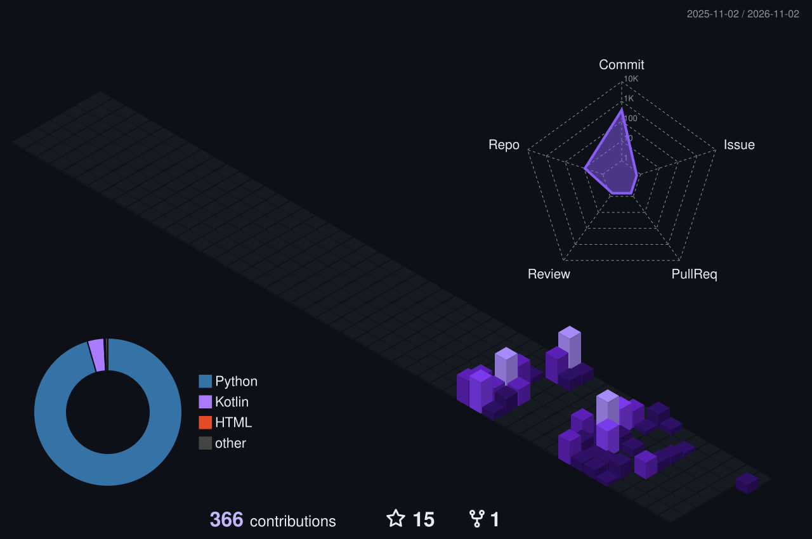

  

  

  
  
  

  
  
  
  

 

## About

<table>
<tr>
<td width="60%" valign="top">

I'm a **B.Tech Computer Engineering** student at SSBT's College of Engineering & Technology, Jalgaon. I build full-stack software that works beyond the demo.

Every project here has a layered architecture, an automated test suite and a README that explains how it works and why. Most also run CI across Ubuntu, Windows and macOS. I like taking one idea all the way: my contact manager started as a desktop app and grew into a multi-user web app with Google OAuth, migrations and 118 tests.

**What I work on**
- **Backend:** REST APIs with Flask and FastAPI · SQLAlchemy · OAuth 2.0 / JWT authentication
- **Frontend:** semantic HTML · CSS design tokens with light/dark themes · vanilla JavaScript
- **Quality:** pytest · GitHub Actions · secure defaults (XSS escaping, CSRF, CORS)
- **Delivery:** PostgreSQL (Supabase) · SQLite · Alembic migrations · Render

</td>
<td width="40%" valign="top" align="center">
  
</td>
</tr>
</table>

## Tech Stack

  

| Area | Technologies |
|---|---|
| **Languages** | Python · JavaScript · HTML · CSS · SQL |
| **Backend** | Flask · FastAPI · SQLAlchemy · Flask-Login · Authlib (Google OAuth) · PyJWT · Pydantic · Jinja2 |
| **Databases** | PostgreSQL (Supabase) · SQLite · Alembic / Flask-Migrate |
| **Desktop & CLI** | CustomTkinter · Tkinter · Rich · pyfiglet |
| **Libraries** | Pillow · psutil · requests · `concurrent.futures` · Gemini API |
| **Testing & DevOps** | pytest · pytest-cov · GitHub Actions (cross-OS matrix) · Render · Git |
| **Learning** | Kotlin · Android Studio (Meta Android Developer courses) |

## Featured Projects

<table>
<tr>
<td width="50%" valign="top">

#### 1 · [Contact Vault v1.0](https://github.com/Aayush29052006/Contact-Vault) · Desktop + CLI

A desktop GUI and a full CLI share one validated, deduplicated data layer. Features RFC-compliant email validation, Command-pattern undo and crash-safe atomic writes.

`CustomTkinter` `email-validator` `pytest` · **cross-OS CI**

</td>
<td width="50%" valign="top">

#### 2 · [Contact Vault v2.0](https://github.com/Aayush29052006/Contact-Vault-V2) · Web

The web successor. A multi-user contact manager with **Google sign-in**, duplicate detection, two-way undo, a permanent activity log, bulk import, CSV/JSON export and light/dark themes.

`Flask` `SQLAlchemy` `Alembic` `Authlib` `Flask-WTF` · **118 tests · cross-OS CI**

</td>
</tr>
<tr>
<td width="50%" valign="top">

#### 3 · [Parallel System Monitor v1.0](https://github.com/Aayush29052006/Parallel-System-Monitor) · Desktop

Polls multiple hosts for CPU and memory **in parallel** with a `ThreadPoolExecutor`, and proves the speed-up with measured timing. Includes a health score, a 24-hour trend graph and status-change history.

`CustomTkinter` `ThreadPoolExecutor` `psutil` `SQLite` · **47 tests · CI**

</td>
<td width="50%" valign="top">

#### 4 · [Parallel System Monitor v2.0](https://github.com/Aayush29052006/Parallel-System-Monitor-V2) · Web

The web version reuses v1's polling engine unchanged. Adds browser-triggered polling, live search and sort, sparkline trends and a 24-hour health chart drawn from real history.

`Flask` `psutil` `SQLite` `JavaScript` · **67 tests**

</td>
</tr>
<tr>
<td width="50%" valign="top">

#### 5 · [Session Ledger](https://github.com/Aayush29052006/Session-Ledger) · CLI

Turns login/logout logs into session history, a live "who's online" view and CSV/JSON reports. It copes with messy real-world logs without crashing.

`Python` `Rich` `pyfiglet` · **27 tests · CI**

</td>
<td width="50%" valign="top">

#### 6 · [Pixel Forge](https://github.com/Aayush29052006/Pixel-Forge) · Web

A batch image converter that reads almost anything, including **HEIC** and **AVIF**, and writes 10 formats. It keeps animations and colour profiles, and one bad file never sinks the batch.

`Flask` `Pillow` `pillow-heif` · **71 tests · v1.1.x**

</td>
</tr>
<tr>
<td width="50%" valign="top">

#### 7 · [Watch Tower](https://github.com/Aayush29052006/Watch-Tower) · Web

A log-alerting service that **never crashes**. It survives corrupted lines, log rotation and truncation, missing files and permission errors, and dedups alert storms. Every failure mode has a test that simulates it.

`Flask` `Python` `JavaScript` · **72 tests**

</td>
<td width="50%" valign="top">

#### 8 · [CareerNexus](https://github.com/Aayush29052006/VertexSquad) · Team Project

**Smart India Hackathon 2026 · Team VertexSquad.** A student uploads a resume, AI extracts their skills, and they're matched to internships with an explainable score and a skill-gap path. Five role-based portals: student, recruiter, faculty, institution and admin.

`FastAPI` `SQLAlchemy` `PostgreSQL` `JWT + Google Sign-In` `Gemini API`

<b>My role:</b> lead developer. I wrote 102 of the 104 commits. Hackathon prototype; live demo currently offline.

</td>
</tr>
</table>

## Experience & Achievements

| | Role / Achievement | Organisation | Date |
|---|---|---|---|
| **Internship** | Data Science Intern · industrial training programme | Uplyx Solutions Pvt. Ltd. | Aug – Oct 2025 |
| **Hackathon** | Selected · Internal Smart India Hackathon 2026 (Team VertexSquad) | SSBT's COET, Jalgaon | Sep 2026 |

## Certifications

| Certification | Issuer | Issued | Verify |
|---|---|---|---|
| **Google IT Automation with Python** (Professional Certificate) | Google | Jul 2026 | [Credly](https://www.credly.com/go/ooZoe48Y) |
| **Google AI Professional Certificate** (7 courses, listed below) | Google | Jul 2026 | — |
| Google AI Essentials | Google | Jul 2026 | [Credly](https://www.credly.com/go/nLCEgbzF) |
| Google Prompting Essentials | Google | Jul 2026 | [Credly](https://www.credly.com/go/JkoyiutO) |
| Google Agile Essentials | Google | Jul 2026 | [Credly](https://www.credly.com/go/oMcSjXpt) |
| Introduction to Android Mobile Application Development | Meta · Coursera | Aug 2026 | [Coursera](https://coursera.org/verify/F436W8KJ08AH) |
| Programming Fundamentals in Kotlin | Meta · Coursera | Aug 2026 | [Coursera](https://coursera.org/verify/T5AJGWVE01JK) |
| Create the User Interface in Android Studio | Meta · Coursera | Aug 2026 | [Coursera](https://coursera.org/verify/MGG36B12CKUL) |
| **Microsoft Azure AI Essentials** (Professional Certificate) | Microsoft · LinkedIn Learning | Aug 2025 | — |
| Microsoft Azure AI Essentials: Workloads and Machine Learning on Azure | Microsoft · LinkedIn Learning | Jul 2025 | — |
| Introduction to Data Science | LinkedIn Learning | Jul 2025 | — |
| Developing a Learning Mindset in the Age of AI | LinkedIn Learning | Jul 2025 | — |
| Master Data Management for Beginners | TCS iON | Jun 2026 | — |

<b>Google AI Professional Certificate: the 7 courses</b>

 

| # | Course | Completed |
|---|---|---|
| 1 | AI Fundamentals | Jul 2026 |
| 2 | AI for Brainstorming and Planning | Jul 2026 |
| 3 | AI for Research and Insights | Jul 2026 |
| 4 | AI for Writing and Communicating | Jul 2026 |
| 5 | AI for Content Creation | Jul 2026 |
| 6 | AI for Data Analysis | Jul 2026 |
| 7 | AI for App Building | Jul 2026 |

## GitHub Activity

  

  

  
  
  

  <picture>
    <source media="(prefers-color-scheme: dark)" srcset="https://raw.githubusercontent.com/Aayush29052006/Aayush29052006/output/github-snake-dark.svg" />
    <source media="(prefers-color-scheme: light)" srcset="https://raw.githubusercontent.com/Aayush29052006/Aayush29052006/output/github-snake.svg" />
    
  </picture>

  <picture>
    <source media="(prefers-color-scheme: dark)" srcset="https://raw.githubusercontent.com/Aayush29052006/Aayush29052006/output/pacman-contribution-graph-dark.svg" />
    <source media="(prefers-color-scheme: light)" srcset="https://raw.githubusercontent.com/Aayush29052006/Aayush29052006/output/pacman-contribution-graph.svg" />
    
  </picture>

Animations and graphs regenerate daily via GitHub Actions.

## Connect

I'm open to **internships** and collaboration on full-stack projects. The fastest way to reach me is LinkedIn or email.

  
  
  

  

