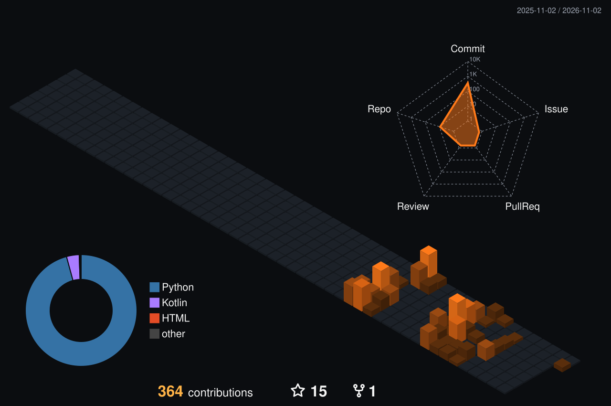

<!-- Profile README for github.com/Aayush29052006 — DRAFT, not yet published -->

  

  

  
  

---

<table>
<tr>
<td width="58%" valign="top">

### Hi, I'm Aayush 👋

I'm a **B.Tech Computer Engineering** student at SSBT's College of Engineering & Technology, Jalgaon, and I build full-stack software in Python.

My projects aren't tutorials. Each one has a layered architecture, a test suite and a README that explains how it works and why. Most have CI on Ubuntu, Windows and macOS. I like taking one idea further than it needs to go: my contact manager started as a desktop app, then became a multi-user web app with Google OAuth and **118 tests**.

- 🔧 **Backend:** REST APIs with Flask and FastAPI, SQLAlchemy, auth (OAuth 2.0 / JWT)
- 🖥️ **Frontend:** semantic HTML, CSS with light/dark design tokens, vanilla JavaScript
- 🧪 **Quality:** pytest, GitHub Actions CI, threat-aware coding (XSS escaping, CORS, CSRF)
- 🚀 **Delivery:** Render deployments, PostgreSQL (Supabase), SQLite, Alembic migrations

</td>
<td width="42%" valign="top" align="center">
  
</td>
</tr>
</table>

---

### 🛠️ Tech Stack

Used in shipped projects on this profile

  

| Area | Technologies |
|---|---|
| **Languages** | Python · JavaScript · HTML · CSS · SQL |
| **Backend** | Flask · FastAPI · SQLAlchemy · Flask-Login · Authlib (Google OAuth) · PyJWT · Pydantic · Jinja2 |
| **Databases** | PostgreSQL (Supabase) · SQLite · Alembic / Flask-Migrate |
| **Desktop & CLI** | CustomTkinter · Tkinter · Rich · pyfiglet |
| **Libraries** | Pillow · psutil · requests · `concurrent.futures` (ThreadPoolExecutor) · Gemini API |
| **Testing & DevOps** | pytest · pytest-cov · GitHub Actions (cross-OS matrix) · Render · Git |

Currently learning: <b>Kotlin & Android</b> (Meta, Coursera), building toward native mobile apps.

---

### 🚀 Featured Projects

Summaries taken from each project's own README. Every project is open source with tests; click through for setup, architecture and screenshots.

#### 🎯 [CareerNexus](https://github.com/Aayush29052006/VertexSquad) &nbsp;·&nbsp; Team VertexSquad · Smart India Hackathon 2026 (PS 26134)

> Students often can't tell how their skills line up against what companies actually hire for. CareerNexus closes that gap.

A student uploads a resume and the platform **extracts their skills with AI**. It then matches them against real internship listings with a **transparent match score**, explains *why* they matched, and shows exactly which skills to learn next. Separate portals serve **students, recruiters, faculty, institutions and admins**.

`Assess → Find Skill Gaps → Learn → Apply → Internship → Get Evaluated → Verified Portfolio → Get Placed`

**Stack:** FastAPI · SQLAlchemy · PostgreSQL (Supabase) · PyJWT + Google Sign-In · Gemini API · pypdf · HTML/CSS/vanilla JS
**My role:** lead developer. I wrote 102 of the 104 commits, covering the frontend, FastAPI backend integration, authentication, XSS hardening and Render deployment.
**Status:** hackathon prototype · live demo currently offline

---

<table>
<tr>
<td width="50%" valign="top">

#### 📇 [Contact Vault v2.0](https://github.com/Aayush29052006/Contact-Vault-V2) · *Web*

A multi-user contact manager: **sign in with Google**, then add, search, edit and delete contacts, with a full audit trail.
- Google OAuth: no passwords ever stored
- Case-insensitive duplicate detection, enforced twice
- Undo two ways, plus a permanent **Activity Log**
- Bulk paste-import · CSV/JSON export · light/dark themes

`Flask` `SQLAlchemy` `Alembic` `Authlib` `Flask-WTF` · **118 tests · cross-OS CI**

</td>
<td width="50%" valign="top">

#### 📡 [Parallel System Monitor v2.0](https://github.com/Aayush29052006/Parallel-System-Monitor-V2) · *Web*

Monitors many hosts **in parallel**, with real-time CPU, memory and latency polling, live status classification and historical trends.
- Concurrent polling engine reused **unchanged** from v1
- "Poll now" + 5-second auto-refresh, updated in place
- Sparklines and a 24-hour health chart from real history
- Live search and sort · expandable host details

`Flask` `ThreadPoolExecutor` `psutil` `SQLite` `Vanilla JS` · **67 tests**

</td>
</tr>
<tr>
<td width="50%" valign="top">

#### 🛡️ [Watch Tower](https://github.com/Aayush29052006/Watch-Tower) · *Web*

Watches a log file for suspicious activity and raises alerts, **without ever crashing**, whatever the log file throws at it.
- Detects brute force, error spikes, restricted actions and login recovery
- Survives corrupted lines, log rotation and truncation, missing files and permission errors
- Isolates each alert channel · dedups alert storms
- Every failure mode backed by a test that simulates it

`Flask` `Python` `Vanilla JS` · **72 tests**

</td>
<td width="50%" valign="top">

#### 🖼️ [Pixel Forge](https://github.com/Aayush29052006/Pixel-Forge) · *Web*

A batch image converter: drop in any number of images, pick a format, resize or rotate, and download the files individually or as a ZIP.
- Reads almost anything, including **HEIC (iPhone)**, **AVIF**, PSD and TIFF
- Writes 10 formats · keeps animations and colour profiles
- Handles CMYK and 16-bit images · batch-safe (one bad file never sinks the batch)
- Fit or Stretch resize · size presets · drag-and-drop

`Flask` `Pillow` `pillow-heif` · **71 tests · v1.1.x**

</td>
</tr>
<tr>
<td width="50%" valign="top">

#### 🗂️ [Contact Vault v1.0](https://github.com/Aayush29052006/Contact-Vault) · *Desktop + CLI*

A cross-platform contact and email-list manager with a modern **desktop GUI** and a **full CLI**, both sharing one validated, deduplicated data layer.
- RFC-compliant email validation · Unicode-aware duplicate detection
- Undo via the Command pattern · CSV bulk import with progress
- Atomic, crash-safe file writes

`CustomTkinter` `email-validator` `pytest` · **cross-OS CI**

</td>
<td width="50%" valign="top">

#### 🧾 [Session Ledger](https://github.com/Aayush29052006/Session-Ledger) · *CLI*

Session tracking, simplified. It reads login/logout event logs and reports **who was on which machine, when, and for how long**.
- Full session history + a live "who's online now" view
- Filter by user or date · export to CSV or JSON
- Copes with messy real-world logs without crashing

`Python` `Rich` `pyfiglet` · **27 tests · CI**

</td>
</tr>
</table>

Also: <a href="https://github.com/Aayush29052006/Parallel-System-Monitor"><b>Parallel System Monitor v1.0</b></a>, the CustomTkinter desktop version, which proves its parallel speed-up with measured timing (CI, 47 tests).

---

### 📊 GitHub Activity

  

  

  
  

  <picture>
    <source media="(prefers-color-scheme: dark)" srcset="https://raw.githubusercontent.com/Aayush29052006/Aayush29052006/output/github-snake-dark.svg" />
    <source media="(prefers-color-scheme: light)" srcset="https://raw.githubusercontent.com/Aayush29052006/Aayush29052006/output/github-snake.svg" />
    
  </picture>

  <picture>
    <source media="(prefers-color-scheme: dark)" srcset="https://raw.githubusercontent.com/Aayush29052006/Aayush29052006/output/pacman-contribution-graph-dark.svg" />
    <source media="(prefers-color-scheme: light)" srcset="https://raw.githubusercontent.com/Aayush29052006/Aayush29052006/output/pacman-contribution-graph.svg" />
    
  </picture>

---

### 🎯 Current Focus

- Designing **REST APIs** and backends that scale past a single user
- **Database design** and query optimisation in PostgreSQL
- Turning prototypes into **deployable products** with CI, docs and security baked in
- **Android development** with Kotlin

---

### 📜 Certifications & Experience

| | Credential | Issuer |
|---|---|---|
| 💼 | **Data Science Intern** (Aug–Oct 2025) | Uplyx Solutions Pvt. Ltd. |
| 🏆 | **Selected, Internal Smart India Hackathon 2026**: Team VertexSquad | SSBT's COET, Jalgaon |
| 🎓 | [Google IT Automation with Python](https://www.credly.com/go/ooZoe48Y) (Professional Certificate) | Google |
| 🎓 | Google AI Professional Certificate (7 courses) | Google |
| 📱 | Meta Android Developer courses: [Intro to Android](https://coursera.org/verify/F436W8KJ08AH), [Kotlin Fundamentals](https://coursera.org/verify/T5AJGWVE01JK), [Android UI](https://coursera.org/verify/MGG36B12CKUL) | Meta · Coursera |
| ☁️ | Microsoft Azure AI Essentials Professional Certificate | Microsoft · LinkedIn Learning |
| 📘 | [Google Agile Essentials](https://www.credly.com/go/oMcSjXpt) · [Google AI Essentials](https://www.credly.com/go/nLCEgbzF) · [Google Prompting Essentials](https://www.credly.com/go/JkoyiutO) | Google |

---

### 🤝 Connect

  
  
  

Open to **internships** and collaboration on full-stack projects.

  

