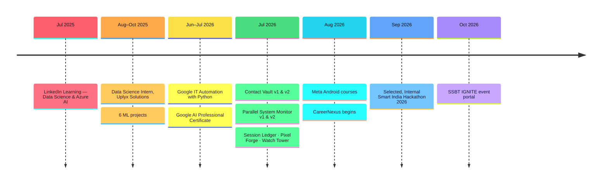
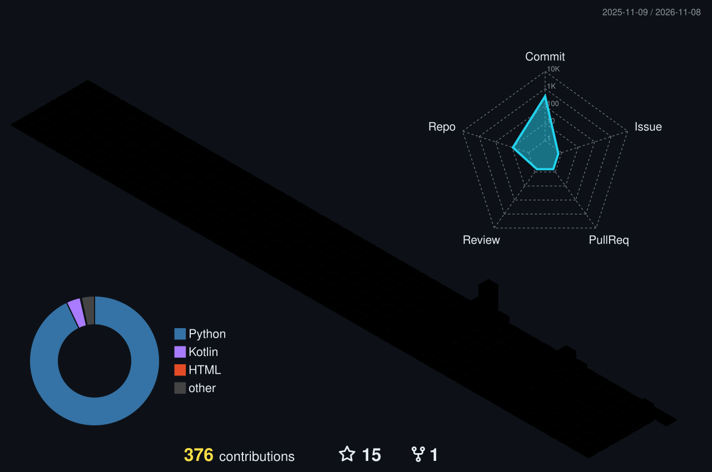

  

  

  
  
  
  

  
  
  
  
  
  

## About

<table>
<tr>
<td width="60%" valign="top">

I'm a third-year **B.Tech Computer Engineering** student at SSBT's College of Engineering & Technology, Jalgaon. I learn by shipping: instead of only collecting certificates, I build working software and back it up with tests, CI and documentation.

Every project here has a layered architecture, an automated test suite and a README that explains how it works and why. Most also run CI across Ubuntu, Windows and macOS. I like taking one idea all the way, from a desktop app to a multi-user web app with Google OAuth, migrations and 118 tests.

- 🟥 **Backend:** REST APIs with Flask, FastAPI and Express · SQLAlchemy · OAuth 2.0 / JWT
- 🟧 **Frontend:** React + Vite · semantic HTML · CSS design tokens · vanilla JavaScript
- 🟨 **Quality:** pytest · Playwright · GitHub Actions · secure defaults (XSS, CSRF, CORS)
- 🟩 **Data:** PostgreSQL (Supabase) · SQLite · Alembic migrations · ML pipelines (internship)
- 🟦 **Delivery:** Render · Vercel · GitHub Actions

</td>
<td width="40%" valign="top" align="center">
  
</td>
</tr>
</table>

## Tech Stack

**Languages** 

**Backend & Frontend** 

**Data, Testing & Delivery** 

**Desktop & CLI** 

Currently learning: <b>Kotlin & Android</b> (Meta Android Developer courses).

## Highlights Timeline

## Featured Projects

<table>
<tr>
<td width="50%" valign="top">

#### 1 · [Contact Vault v1.0](https://github.com/Aayush29052006/Contact-Vault) · Desktop + CLI

A desktop GUI and a full CLI share one validated, deduplicated data layer. Features RFC-compliant email validation, Command-pattern undo and crash-safe atomic writes.

  

</td>
<td width="50%" valign="top">

#### 2 · [Contact Vault v2.0](https://github.com/Aayush29052006/Contact-Vault-V2) · Web

The web successor: a multi-user contact manager with **Google sign-in**, duplicate detection, two-way undo, a permanent activity log, bulk import and CSV/JSON export.

  

</td>
</tr>
<tr>
<td width="50%" valign="top">

#### 3 · [Parallel System Monitor v1.0](https://github.com/Aayush29052006/Parallel-System-Monitor) · Desktop

Polls many hosts for CPU and memory **in parallel**, with a **~3× speed-up measured in its test suite** (1.51 s → 0.51 s). Includes a health score, a 24-hour trend graph and status-change history.

  

</td>
<td width="50%" valign="top">

#### 4 · [Parallel System Monitor v2.0](https://github.com/Aayush29052006/Parallel-System-Monitor-V2) · Web

The web version reuses v1's polling engine unchanged. Adds browser-triggered polling, live search and sort, sparkline trends and a 24-hour health chart from real history.

  

</td>
</tr>
<tr>
<td width="50%" valign="top">

#### 5 · [Session Ledger](https://github.com/Aayush29052006/Session-Ledger) · CLI

Turns login/logout logs into session history, a live "who's online" view and CSV/JSON reports. It copes with messy real-world logs without crashing.

  

</td>
<td width="50%" valign="top">

#### 6 · [Pixel Forge](https://github.com/Aayush29052006/Pixel-Forge) · Web

A batch image converter that reads almost anything, including **HEIC** and **AVIF**, and writes 10 formats. It keeps animations and colour profiles, and one bad file never sinks the batch.

  

</td>
</tr>
<tr>
<td width="50%" valign="top">

#### 7 · [Watch Tower](https://github.com/Aayush29052006/Watch-Tower) · Web

A log-alerting service that **never crashes**. It survives corrupted lines, log rotation, missing files and permission errors, and dedups alert storms. Every failure mode has a test that simulates it.

  

</td>
<td width="50%" valign="top">

#### 8 · [CareerNexus](https://github.com/Aayush29052006/VertexSquad) · Team Project

**Smart India Hackathon 2026 · Team VertexSquad.** A student uploads a resume, AI extracts their skills, and they're matched to internships with an explainable score and a skill-gap path. Five role-based portals.

  

<b>My role:</b> lead developer. I wrote 102 of the 104 commits. Hackathon prototype; live demo currently offline.

</td>
</tr>
</table>

#### 9 · SSBT IGNITE: Online Event Portal · Team Project ·  

A cinematic, **Harry Potter-inspired** onboarding and event portal for the SSBT IGNITE entrepreneurship event. Participants sign in with Google and apply for admission. Organisers approve them, then a Sorting Hat quiz assigns each student to a House, and the whole site takes on that House's colours. Inside: a Task Library across five phases, a Daily Riddle, leaderboards, a portrait studio, and an admin "Headmaster's Office". Built to stay fast on low-end phones (about 111 KB of gzipped JavaScript, no WebGL), with music and sound effects generated live in the browser.

      

<b>Role:</b> co-developer, built with Piyush Mali. The source is in a private repository.

## Experience & Achievements

| | Role / Achievement | Organisation | Date |
|---|---|---|---|
| 🟩 **Internship** | **Data Science Intern**: worked through the full ML pipeline on 6 projects, including a heart-failure prediction model comparing 7 algorithms | Uplyx Solutions Pvt. Ltd. | Aug – Oct 2025 |
| 🟦 **Hackathon** | **Selected**, Internal Smart India Hackathon 2026 (Team VertexSquad, PS 26134) | SSBT's COET, Jalgaon | Sep 2026 |

## Certifications

| Certification | Issuer | Issued | Verify |
|---|---|---|---|
| **Google IT Automation with Python** (Professional Certificate) |  | Jul 2026 | [Credly](https://www.credly.com/go/ooZoe48Y) |
| **Google AI Professional Certificate** (7 courses, listed below) |  | Jul 2026 | — |
| Google AI Essentials |  | Jul 2026 | [Credly](https://www.credly.com/go/nLCEgbzF) |
| Google Prompting Essentials |  | Jul 2026 | [Credly](https://www.credly.com/go/JkoyiutO) |
| Google Agile Essentials |  | Jul 2026 | [Credly](https://www.credly.com/go/oMcSjXpt) |
| Introduction to Android Mobile Application Development |  | Aug 2026 | [Coursera](https://coursera.org/verify/F436W8KJ08AH) |
| Programming Fundamentals in Kotlin |  | Aug 2026 | [Coursera](https://coursera.org/verify/T5AJGWVE01JK) |
| Create the User Interface in Android Studio |  | Aug 2026 | [Coursera](https://coursera.org/verify/MGG36B12CKUL) |
| **Microsoft Azure AI Essentials** (Professional Certificate) |  | Aug 2025 | — |
| Microsoft Azure AI Essentials: Workloads and Machine Learning on Azure |  | Jul 2025 | — |
| Introduction to Data Science |  | Jul 2025 | — |
| Developing a Learning Mindset in the Age of AI |  | Jul 2025 | — |
| Master Data Management for Beginners |  | Jun 2026 | — |

<b>Google AI Professional Certificate: the 7 courses</b>

 

| # | Course | Completed |
|---|---|---|
| 1 | AI Fundamentals | Jul 2026 |
| 2 | AI for Brainstorming and Planning | Jul 2026 |
| 3 | AI for Research and Insights | Jul 2026 |
| 4 | AI for Writing and Communicating | Jul 2026 |
| 5 | AI for Content Creation | Jul 2026 |
| 6 | AI for Data Analysis | Jul 2026 |
| 7 | AI for App Building | Jul 2026 |

## GitHub Activity

  

  

  
  
  

  <picture>
    <source media="(prefers-color-scheme: dark)" srcset="https://raw.githubusercontent.com/Aayush29052006/Aayush29052006/output/github-snake-dark.svg" />
    <source media="(prefers-color-scheme: light)" srcset="https://raw.githubusercontent.com/Aayush29052006/Aayush29052006/output/github-snake.svg" />
    
  </picture>

  <picture>
    <source media="(prefers-color-scheme: dark)" srcset="https://raw.githubusercontent.com/Aayush29052006/Aayush29052006/output/pacman-contribution-graph-dark.svg" />
    <source media="(prefers-color-scheme: light)" srcset="https://raw.githubusercontent.com/Aayush29052006/Aayush29052006/output/pacman-contribution-graph.svg" />
    
  </picture>

#### Recent activity

<!--START_SECTION:activity-->
<!--END_SECTION:activity-->

Graphs, animations and the activity feed refresh automatically via GitHub Actions.

## Connect

I'm open to **internships** and collaboration on full-stack projects. The fastest way to reach me is LinkedIn or email.

  
  
  
  

  

